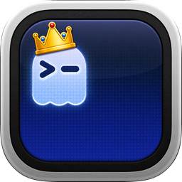
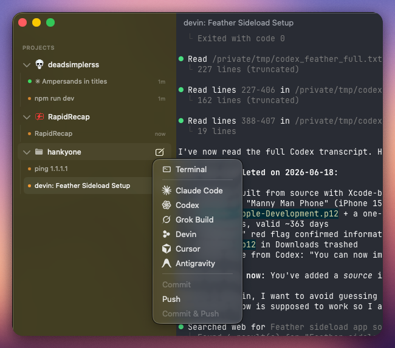

<p align="center">
  
</p>

<h1 align="center">Ghostty Pro Plus Ultra</h1>

<p align="center">
A personal Ghostty fork with a project-grouped sidebar, AI agent integration, on-device AI commit messages, and quality-of-life improvements for macOS.
</p>

<p align="center">
  
</p>

## Features

### Project-Grouped Sidebar

A T3 Code-inspired sidebar that replaces the native tab bar. Terminals are automatically grouped by project — detected from `.git`, `package.json`, `Cargo.toml`, and other markers. Each project section shows auto-detected favicons (from Xcode, Android, or web projects), git diff stats, and a collapsible tab list. Ungrouped terminals live in an "Other" section at the bottom.

### AI Agent Integration

Built-in support for Claude Code, Codex, Grok, OpenCode, Devin, Cline, Cursor and Antigravity. The sidebar shows live status for each session: an open ring while the model is reasoning, a square while a tool runs, orange when it is waiting on you, green when a turn finished while you were elsewhere. Hovering names the running tool. Each project header has a button to start a new session there. Sessions are resumed for you when the app restarts, not from a button. See [Agent Status](#agent-status) for which agents report which states.

### Git Integration

Each project header shows live git diff stats (`+N -N`) that update as you edit files, powered by FSEvents file watching with a 2-second debounce. The project menu includes Commit, Push, and Commit & Push actions — commit messages are generated on-device using the Foundation Models framework (Apple Intelligence), so there's no paid API or cloud dependency. Requires macOS 26+ with Apple Intelligence enabled.

### Tab Restore

Browser-like session persistence — quit and reopen, and everything comes back. Working directories, tab titles, colors, sidebar metadata, and agent resume commands are all preserved across restarts.

### Agent Status

No setup. Install an agent, run it in a tab, and the sidebar follows along.

The agent is recognised from the process running in the tab, so nothing has
to be registered and nothing has to announce itself. Its state then comes
from the record it already keeps of its own conversation, which cannot drift
out of sync with what is on screen because it is the same thing you are
reading.

| Agent | Found by | Read from | Reports |
| --- | --- | --- | --- |
| Grok | Working directory | Session event log | Thinking, tool, waiting for you, finished |
| Codex | Working directory | Session event log | Thinking, tool, working, finished, aborted |
| Claude | Session id, from the wrapper below | Session transcript | Thinking, tool, working, finished |
| OpenCode | Working directory | Session database | Working, finished |
| Devin | Working directory | Session database | Running tool, whose turn it is |
| Cline | Working directory | Session database | Working, finished |

Cursor and Antigravity are recognised but not yet read. Cursor keeps its
conversation as a protobuf blob tree and Antigravity marks every step
complete as it writes it, so neither yields a live state cheaply. Both fall
back to the plain process indicator.

Two things worth knowing. An agent writes nothing until you send it a first
prompt, so a freshly opened one has no state to report and the sidebar says
so rather than guessing. And agents found by working directory share a
reading when two tabs sit in the same folder running the same agent.

Reading is cheap by design. One file handle and one kernel watch per live
session, nothing polls, a log read looks only at the tail of the file, and a
database read is a single indexed query.

**Claude only:** a wrapper earlier in `PATH` passes Claude Code a settings
file at launch. It is the one agent whose session is found by id rather than
by folder, which is also what lets it report an approval prompt and the text
of your last message. The wrapper is written automatically, applies only
inside this app, and steps aside if you have wired up ghostty hooks
yourself. It needs `jq`.

> **Upgrading from an older version?** Earlier releases asked you to install
> hooks permanently into `~/.claude/settings.json`. Those fired in every
> terminal on the machine, not just this one. They are removed automatically
> on first launch; only entries pointing at our own scripts are touched, and
> the original file is kept beside it as `settings.json.pre-ghostty-shim`.
> The scripts left in `~/.claude/hooks/` are inert and can be deleted.


### CLI

Install: symlink `cli/ghosttyctl` to somewhere on your PATH (e.g. `~/.local/bin/ghosttyctl`).

<<<<<<< HEAD
```bash
ghosttyctl rename "My Tab"                                    # rename tab
ghosttyctl notify --title "Done" --body "Build finished"      # send notification
ghosttyctl set-status server "localhost:3000" --icon network  # add status entry
ghosttyctl clear-status server                                # remove it
ghosttyctl list                                               # list all tabs
ghosttyctl current                                            # current tab info
=======
#### Rich Windowing Features

The Mac and Linux (build with GTK) apps support multi-window, tabbing, and
splits with additional features such as tab renaming, coloring, etc. These
features allow for a higher degree of organization and customization than
single-window terminals.

#### Native Platform Experiences

Ghostty is a cross-platform terminal emulator but we don't aim for a
least-common-denominator experience. There is a large, shared core written
in Zig but we do a lot of platform-native things:

- The macOS app is a true SwiftUI-based application with all the things you
  would expect such as real windowing, menu bars, a settings GUI, etc.
- macOS uses a true Metal renderer with CoreText for font discovery.
- macOS supports AppleScript, Apple Shortcuts (AppIntents), etc.
- The Linux app is built with GTK.
- The Linux app integrates deeply with systemd if available for things
  like always-on, new windows in a single instance, cgroup isolation, etc.

Our goal with Ghostty is for users of whatever platform they run Ghostty
on to think that Ghostty was built for their platform first and maybe even
exclusively. We want Ghostty to feel like a native app on every platform,
for the best definition of "native" on each platform.

#### Cross-platform `libghostty` for Embeddable Terminals

In addition to being a standalone terminal emulator, Ghostty is a
C-compatible library for embedding a fast, feature-rich terminal emulator
in any 3rd party project. This library is called `libghostty`.

Due to the scope of this project, we're breaking libghostty down into
separate libraries, starting with `libghostty-vt`. The goal of
this project is to focus on parsing terminal sequences and maintaining
terminal state. This is covered in more detail in this
[blog post](https://mitchellh.com/writing/libghostty-is-coming).

`libghostty-vt` is already available and usable today for Zig and C and
is compatible for macOS, Linux, Windows, and WebAssembly. The functionality
is extremely stable (since its been proven in Ghostty GUI for a long time),
but the API signatures are still in flux.

`libghostty` is already heavily in use. See [`examples`](https://github.com/ghostty-org/ghostty/tree/main/example)
for small examples of using `libghostty` in C and Zig or the
[Ghostling](https://github.com/ghostty-org/ghostling) project for a
complete example. See [awesome-libghostty](https://github.com/Uzaaft/awesome-libghostty)
for a list of projects and resources related to `libghostty`.

`libghostty-vt` is released on its own, separately from Ghostty, with
`vt-X.Y.Z` tags. To build or package it, see
[`PACKAGING-LIBGHOSTTY.md`](PACKAGING-LIBGHOSTTY.md). To use it from a
CMake project, see [`dist/cmake/README.md`](dist/cmake/README.md). We're
still working on a better docs experience, but our
[Doxygen website](https://libghostty.tip.ghostty.org/) is a good resource
for the C API.

#### Ghostty-only Terminal Control Sequences

We want and believe that terminal applications can and should be able
to do so much more. We've worked hard to support a wide variety of modern
sequences created by other terminal emulators towards this end, but we also
want to fill the gaps by creating our own sequences.

We've been hesitant to do this up until now because we don't want to create
more fragmentation in the terminal ecosystem by creating sequences that only
work in Ghostty. But, we do want to balance that with the desire to push the
terminal forward with stagnant standards and the slow pace of change in the
terminal ecosystem.

We haven't done any of this yet.

## Crash Reports

Ghostty has a built-in crash reporter that will generate and save crash
reports to disk. The crash reports are saved to the `$XDG_STATE_HOME/ghostty/crash`
directory. If `$XDG_STATE_HOME` is not set, the default is `~/.local/state`.
**Crash reports are _not_ automatically sent anywhere off your machine.**

Crash reports are only generated the next time Ghostty is started after a
crash. If Ghostty crashes and you want to generate a crash report, you must
restart Ghostty at least once. You should see a message in the log that a
crash report was generated.

> [!NOTE]
>
> Use the `ghostty +crash-report` CLI command to get a list of available crash
> reports. A future version of Ghostty will make the contents of the crash
> reports more easily viewable through the CLI and GUI.

Crash reports end in the `.ghosttycrash` extension. The crash reports are in
[Sentry envelope format](https://develop.sentry.dev/sdk/envelopes/). You can
upload these to your own Sentry account to view their contents, but the format
is also publicly documented so any other available tools can also be used.
The `ghostty +crash-report` CLI command can be used to list any crash reports.
A future version of Ghostty will show you the contents of the crash report
directly in the terminal.

To send the crash report to the Ghostty project, you can use the following
CLI command using the [Sentry CLI](https://docs.sentry.io/cli/installation/):

```shell-session
SENTRY_DSN=https://e914ee84fd895c4fe324afa3e53dac76@o4507352570920960.ingest.us.sentry.io/4507850923638784 sentry-cli send-envelope --raw <path to ghostty crash>
>>>>>>> upstream/main
```

### Config

```
# Choose which fields to show (default: all)
sidebar-fields = title,directory,git-branch,status
```

### Auto-Update

Built-in Sparkle auto-updates. The app checks for new versions automatically and prompts to install.

## Building

```bash
zig build       # debug build
zig build run   # build and launch
```

See [HACKING.md](HACKING.md) for full build instructions.

## Attribution

This project is built on top of:

- [Ghostty](https://github.com/ghostty-org/ghostty) by Mitchell Hashimoto — the original terminal emulator ([ghostty.org](https://ghostty.org))
- [pacaya/ghostty](https://github.com/pacaya/ghostty) (aka [tomreinert/ghostty](https://github.com/tomreinert/ghostty)) — added the sidebar tab system

Not affiliated with the upstream Ghostty project.
